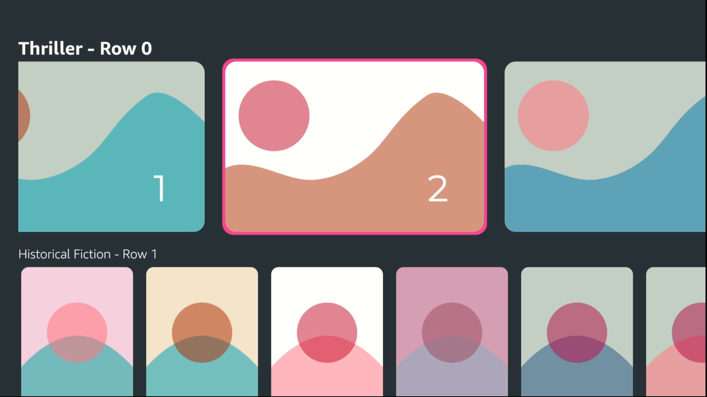
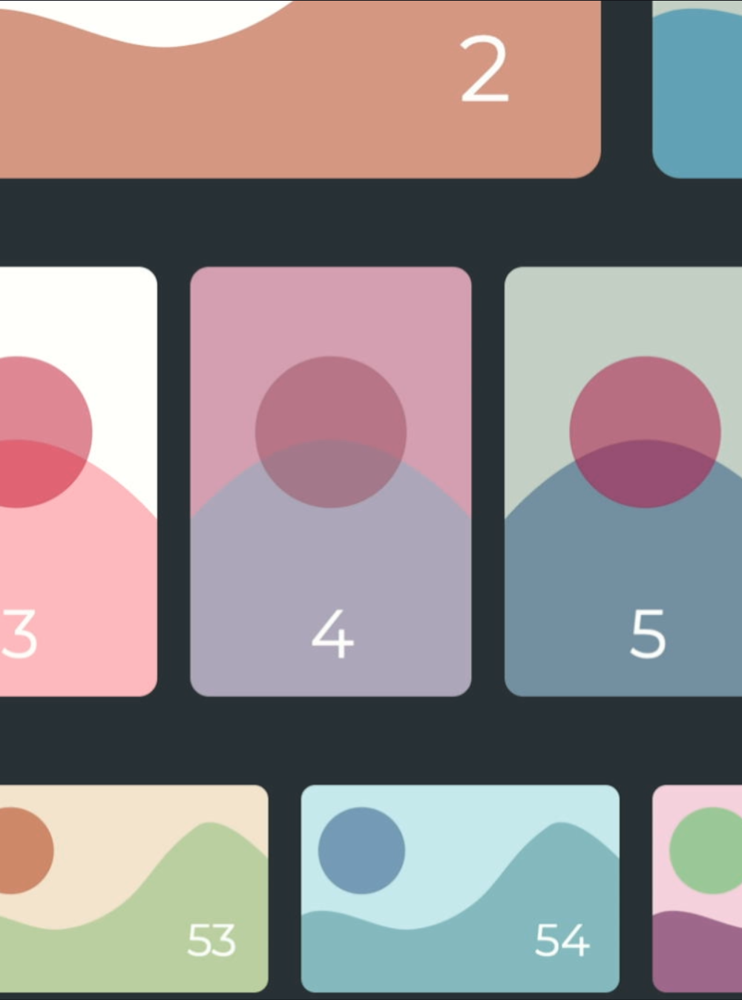
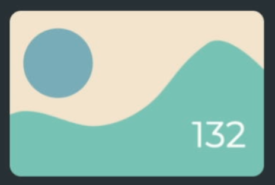
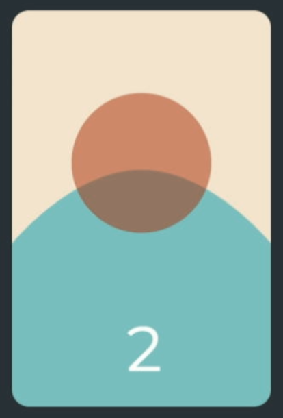
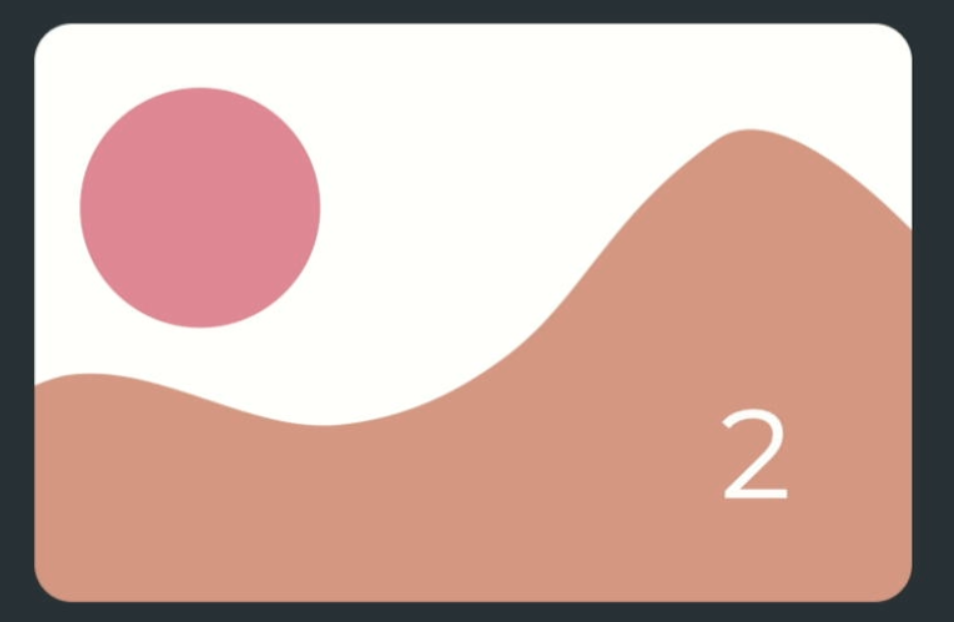
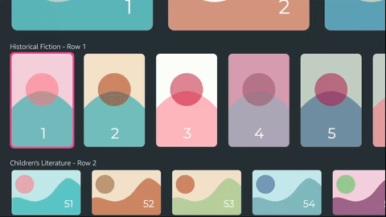
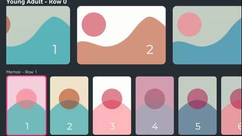
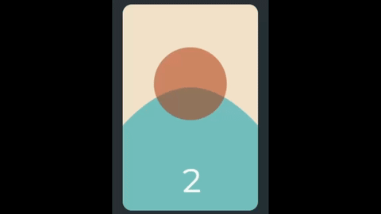

Vega Scrolling Sample App
=========================

The Vega Scrolling Sample App demonstrates how to build a home page grid layout using Vega components.




Introduction
------------

 The Vega Scrolling Sample App is optimized using the best practices for each component such as memoizing and avoiding state updates. The app is also configurable, allowing you to easily modify the elements while maintaining the optimizations. The grid is built with the Vega `Carousel` component (`@amazon-devices/vega-carousel`), which recycles list items and scrolls on native threads. To learn more about list components, see the [List components](#lists-components) section and [Demo videos](#demo-videos).


Branches
--------

> **Heads up:** `main` targets **Vega OS 2.0** and needs Vega SDK 2.0. `release-rn-83` targets **Vega OS 1.2**. Both set their OS in the `[os.version]` section of `manifest.toml`; `release-rn-0.72` does not set one. Check the branch you're on before you build.

| Branch | React Native | Vega OS | Use when |
|--------|--------------|---------|----------|
| [`main`](https://github.com/AmazonAppDev/vega-scrolling-sample/tree/main) | 0.83 | 2.0 (`min` and `target` in manifest) | You're building for Vega OS 2.0 (the default) |
| [`release-rn-83`](https://github.com/AmazonAppDev/vega-scrolling-sample/tree/release-rn-83) | 0.83 | 1.2 (`min` and `target` in manifest) | You need React Native 0.83 on Vega OS 1.2 devices |
| [`release-rn-0.72`](https://github.com/AmazonAppDev/vega-scrolling-sample/tree/release-rn-0.72) | 0.72 | Not set in manifest | You need the older React Native 0.72 setup; build it with the older Vega SDK it was written for |


Build and run the app
--------------------

### Prerequisites

Before you launch the sample app, make sure that you have [installed the Vega SDK](https://developer.amazon.com/docs/vega/2.0/install-vega-sdk).

> **Check the branch first.** `main` needs Vega SDK 2.0. Install a 2.0.x SDK and set it as the default with `vega sdk use <version>` ([Vega 2.0 Get Started guide](https://developer.amazon.com/docs/vega/2.0/vega-get-started)). Other branches target an older OS. See [Branches](#branches), and confirm with `[os.version]` in `manifest.toml`.

On `main`, the `[os.version]` section of `manifest.toml` sets both `min` and `target` to `2.0`, as recommended for SDK 2.0. The build fails if that section is missing. See [Target OS versions](https://developer.amazon.com/docs/vega/2.0/target-os-version).


### Step 1: Build the app

After you download the source code from GitHub, you can build the Vega Scrolling Sample App from the command line to generate VPKG files. The VPKG files run on the Vega Virtual Device and Vega Fire TV Stick.

You can also use [Vega Studio](https://developer.amazon.com/docs/vega/latest/setup-extension.html) with Visual Studio Code to build the app.

1. At the command prompt, navigate to the Vega Scrolling Sample App source code directory. 

2. To install the app dependencies, run the following command. 

   ```
   npm install
   ```

3. To build the app to generate .vpkg files, run the following command.

   ```
   npm run build:app
   ```

4. At the command prompt, in the **build** folder, verify that you generated the VPKG files for your device's architecture.

   * **armv7-release/keplerscrollingapp_armv7.vpkg**&mdash;generated on x86_64 and Mac-M series devices to run on the Vega Fire TV Stick.
   * **x86_64-release/keplerscrollingapp_x86_64.vpkg**&mdash;generated on x86_64 device to run on the Vega Virtual Device (VVD).
   * **aarch64-release/keplerscrollingapp_aarch64.vpkg**&mdash;generated on Mac M-series device to run on the VVD.
   
### Step 2: Run the app

#### Vega Virtual Device

1. To start the Vega Virtual Device, at the command prompt, run the following command.

   ```
   vega virtual-device start
   ```

2. Go to the directory where you placed the VPKG files. 

3. To install and launch the app on the Vega Virtual Device, run the following command, depending on your device architecture.

   - On Mac M-series based devices. 
      
      ```
      vega run-app build/aarch64-release/keplerscrollingapp_aarch64.vpkg com.amazondeveloper.keplerscrollingapp.main -d VirtualDevice
      ```

   - On x86_64 based devices.
      
     ```
     vega run-app build/x86_64-release/keplerscrollingapp_x86_64.vpkg com.amazondeveloper.keplerscrollingapp.main -d VirtualDevice
     ```  

#### Fire TV Stick

1. Turn on your Fire TV Stick.

2. To install and launch the app on your Fire TV Stick, run the following command.

   ```
   vega run-app build/armv7-release/keplerscrollingapp_armv7.vpkg com.amazondeveloper.keplerscrollingapp.main -d <DSN>
   ```
Demo videos
--------------


### Carousel demo

<video src="docs/images/CarouselDemo.mp4" controls preload></video>

https://github.com/user-attachments/assets/049caff7-aa1f-4377-b0b6-e8def528674e


Configure the App
-----------------

The files in the **src/config/** folder allow you to customize the visual appearance and behavior of the Scrolling App. These configuration values are also used to lay out the `Carousel` rows. When you make configuration changes, the lists are optimized for the new layout. It is recommended that you first make changes in **src/config/** before making changes in other files.

### Card configuration (CARD_CONFIG)

Card configuration controls the appearance of three different card types: `HERO`, `VERTICAL`, and `REGULAR`. For more information about the card types, see [Card variations](#card-variations).

For each card type, you can configure the following:

#### Title settings

* `HEIGHT`: Vertical space for the title.
* `FONT_SIZE`: Text size of the title.
* `FONT_WEIGHT`: Boldness of the title (for example, `300` and `700`).

#### Card settings

* `HEIGHT`: Card height.
* `WIDTH`: Card width.
* `BORDER_RADIUS`: Corner rounding of the card.
* `RESOLUTION`: Image resolution (`720`, `400`, `260`).
* `GAP`: Horizontal spacing between cards.
* `ROW_GAP`: Vertical spacing between rows.


### Row configuration (ROW_CONFIG)

Controls the layout of card rows. For each card type, you can set the following:

- `ITEM_COUNT`: Number of items to display.
- `HEIGHT`: Total row height (automatically calculated).
- `WIDTH`: Total width of row item (automatically calculated).

Grid layout
-----------

The Scrolling app implements a grid layout populated with rounded [`Card`](#card-component) components, designed to simulate a typical movie or TV content browsing interface. This layout follows a common design pattern known as a [horizontal stack layout](https://developer.android.com/design/ui/tv/guides/styles/layouts#horizontal-stack-layout), widely used in TV and streaming applications.


### Nested list structure

The grid is implemented using nested list components. Each row has [`Card`](#card-component) components stored in a horizontally scrollable list (`CardRow`). Then these horizontal lists are arranged in a vertical list to enable vertical scrolling (`Grid`). The [**CarouselGrid.tsx**](src/components/Carousel/CarouselGrid.tsx) file includes the implementation of the vertical list.

* **Horizontal list** (`CardRow`)

  * Each row contains a horizontal list of cards.
  * Represents a single category or content type.
  * Allows horizontal scrolling within each row.

* **Vertical list** (`Grid`)

  * Combines multiple horizontal rows vertically.
  * Enables overall grid navigation and scrolling.


### Heterogenous list

#### Challenges

The rows of the grid have different sized cards. This creates a non-uniform, or heterogenous list structure for the vertical list. The `Carousel` component relies on predictable and uniform item sizes to optimize performance. Uniform item sizes allows these lists to pre-calculate the position and layout of items. However, with heterogeneous items, each row potentially presents a different height and layout. This forces the rendering engine to perform complex, computationally expensive calculations for every scroll and item placement.





#### Solution

To mitigate the challenge, you can instruct the lists about the different item and their dimensions. If the vertical list knows all the possible types of rows and their dimensions, then it is able to perform those pre-calculations. Also, the lists create separate recycling pools for each item type to avoid additional layout calculations. With `Carousel`, each row type is its own component, and each row sets its height from the precomputed `ROW_CONFIG`. The Scrolling app includes the base implementation of the [`CardRow`](src/components/Carousel/CarouselCardRow.tsx), and then created variations of that component for the different card types [`CardRowVariations`](src/components/CardRowVariations.tsx).


 **Note**: Even with this solution, lists with uniform items perform better than heterogenous lists. Among other reasons, maintaining different recycling pools of the different item types consume more memory.

Card component
--------------

`Card` is the fundamental component of this app. It populates the `Grid` and comprises the bulk of the rendering. The Scrolling app renders >3000 `Card` components on startup. See the following details about `Card`.

- [A simple component structure](#a-simple-component-structure)
- [Eliminating state updates](#eliminating-state-updates)
- [Appropriate image resolutions](#appropriate-image-resolutions)

### A simple component structure

The `Card` component is comprised of very few elements. `Card` is an image with a border focus effect and is easily recycled and rendered.

### Eliminating state updates

State updates causes re-renders. Because there are many `Card` components on-screen, any re-render is costly. State updates do not work well with recycling lists such as `Carousel`.

### Appropriate image resolutions

Image selection is critical for optimizing visual quality and performance. Image resolution should precisely match the container size. Larger resolutions are scaled down to match the container. The extra resolution wastes memory and causes network delay. You must pick the minimum resolution for images to be clear and crisp to optimize your app for the typical TV viewing distance of 10 feet.


### Card variations

TV apps often have different types of cards to provide different emphasis to their content. These cards can vary in both shape and size. The following explains the details of the regular card, vertical card, and hero card. 


#### Regular card: the catalog workhorse

The Regular Card is the foundational element of the grid, designed as a compact and versatile component that enables broad catalog representation while maximizing information density. Its smaller size makes it ideal for displaying extensive content collections, providing quick, at-a-glance information that remains readable even when numerous items are presented simultaneously.

* **height:** 175 px
* **width:** 300 px
* **Items per row:** 40




### Vertical card: visual diversity

The Vertical Card introduces a distinctive elongated profile that breaks visual monotony and offers a unique browsing experience. Its elongated design provides visual contrast and supports alternative content presentation, allowing interfaces to create rhythm and visual interest within the grid. This card type is particularly effective for highlighting vertically-oriented content and accommodating different media types that don't fit traditional horizontal layouts.

* **height:** 400 px
* **width:** 250 px
* **Items per row:** 80




### Hero card: emphasizing priority content

The Hero Card serves as a visual anchor, drawing immediate user attention to key content through its significantly larger dimensions. Positioned strategically, typically at the top of a page or section, this card type creates a strong visual hierarchy that guides users to the most important or featured content. Its substantial size introduces more complex focus interactions, challenging traditional navigation patterns and providing a dynamic focal point in the interface.

- **height:** 400 px
- **width:** 700 px
- **Items per row:** 50



Lists components
----------------

Lists are a vital part of TV apps. Lists are used to display an content catalogue of an app similarly to the Scrolling app. Vega provides several options for creating lists of elements:

* `ScrollView`
* `FlatList`
* `Carousel`

The Scrolling app uses `Carousel`, whose strength comes from recycling list items. It uses nested lists with a horizontal list for each row (`CardRow`) and a vertical list (`Grid`) to create a grid.

### Key Performance Indicators (KPI) for list components

Performance test scripts can be found in the `test/performance` folder. The `generalTest.py` script tests the entire app layout. This is the test that was used to obtain the performance numbers in the following table for the `Carousel` component. To run and set up performance testing, see [Measure Your App KPIs](https://developer.amazon.com/docs/vega/latest/measure-app-kpis.html).

| List component | PO | P50 | P90 | P95 | P99 | P100 | stdev | variance |
| -------------- | -- | --- | --- | --- | --- | ---- | ----- | -------- |
| `Carousel`     | 99.8 | 99.38 | 98.88 | 98.63 | 98.63 | 98.63 | 0.3 | 0.09 |


### Carousel

`Carousel` is provided by [`@amazon-devices/vega-carousel`](https://www.npmjs.com/package/@amazon-devices/vega-carousel). **Version >= 1.0 is required for RN 0.83 compatibility.** The V1 carousel from `@amazon-devices/kepler-ui-components` 2.x does not support RN 0.83.

Carousel is built natively for Vega, performing scrolling operations on native threads for best-in-class performance. Because it is a native Vega component, it does not work in cross-platform React Native apps.

For full API documentation, see the [vega-carousel README](https://www.npmjs.com/package/@amazon-devices/vega-carousel?activeTab=readme).

#### Key props

| Prop | Description |
|------|-------------|
| `dataAdapter` | Provides items to the carousel via `getItem`, `getItemCount`, and `getItemKey` |
| `renderItem` | Renders each item given a `CarouselRenderInfo` |
| `selectionStrategy` | Focus behavior: `'natural'`, `'anchored'`, or `'pinned'` |
| `selectionBorder` | Native focus ring configuration (strategy, color, width, radius) |
| `itemStyle` | Controls padding, scale factors on selection/press |
| `orientation` | `'horizontal'` (default) or `'vertical'` |
| `pinnedSelectedItemOffset` | Percentage offset for pinned focus (e.g. `'44%'`) |

#### Data adapter pattern

`Carousel` uses a data adapter for lazy item resolution:

```tsx
const dataAdapter = {
  getItem: (index: number) => data[index],
  getItemCount: () => data.length,
  getItemKey: (info: CarouselRenderInfo) => `${info.index}`,
  notifyDataError: () => false,
};
```

#### Selection strategy

- **`'natural'`** — Focus freely moves between visible items; the list scrolls when focus reaches the edge.
- **`'anchored'`** — Focus stays fixed at one position; content scrolls beneath it.
- **`'pinned'`** — Focus is pinned at a configurable offset (`pinnedSelectedItemOffset`).


Customize scrolling
-------------------

Two common types of scrolling behaviors are natural and fixed scrolling. The difference between two types is how the list scrolls relative to the focused element on the screen.

### Natural scrolling

Focus will freely move between all the elements in the current viewable window. When focus moves beyond the viewable window, the window will scroll to reveal the next focusable element.



### Fixed scrolling

Focus is fixed, or trapped to one position on the screen. Common positions are at the start, middle, or end of a list. When focus changes, the window scrolls to move the newly focused element to the same position.



### Carousel

#### Anchored scrolling (default)

The default `selectionStrategy` is `'anchored'` — the focused item stays fixed in position while content scrolls beneath it.

```tsx
<Carousel
    selectionStrategy="anchored"
    ...
/>
```

#### Pinned scrolling

Pin the focused item at a specific percentage offset:

```tsx
<Carousel
    selectionStrategy="pinned"
    pinnedSelectedItemOffset="44%"
    ...
/>
```

#### Natural scrolling

Set `selectionStrategy` to `'natural'` — focus moves freely between visible items and the list scrolls when focus reaches the edge:

```tsx
<Carousel
    selectionStrategy="natural"
    ...
/>
```

## Focus effects

In television application design, the focus state is crucial for user navigation. The Scrolling app shows focus through a bright border, or "focus ring", drawn natively by `Carousel` from each row's `selectionBorder` prop. The animation approach below is general guidance for custom focus effects. The distinctive visual indicator helps users track their current selection across the grid interface, transforming a static display into an interactive experience by providing clear and animated feedback about the active item.




### Using animation

The optimal method to apply a focus effect is using the React Native Animated API. For more information, see [React Native Animations](https://reactnative.dev/docs/animations).

#### Native animations

The main advantage of implementing the focus effect through the Animated API is leveraging native animations. The Animated API has an option called `useNativeDriver`. This sends the animation configuration to the native thread and performs the animation natively. This frees up the JS thread for other purposes.

However, there are limits to this approach. Only specific style properties like `opacity` and `transform` can be implemented using the `useNativeDriver`. For more information, see [React Native Animations](https://reactnative.dev/docs/animations#caveats).

#### No state updates required

Another advantage of this approach is that it requires no state updates and greatly decreases the number of re-renders.

#### Implementation

Because `borderWidth` can't be animated using the native driver, `opacity` is used. In a custom card, you can place an `Animated.View` behind the image. The `Animated.View` is initially invisible (`opacity = 0`). But, on focus, the animation triggers to make it visible (`opacity = 1.0`).

```tsx
const animationValue = useAnimatedValue(0);

const focusHandler = useCallback(() => {
  Animated.timing(animationValue, {
    toValue: 1,
    duration: 100,
    useNativeDriver: true,
  }).start();
}, [data.index, data.rowIndex]);

<Pressable onFocus={focusHandler}>
  ...
  <Animated.View
    style={[
      {
        position: 'absolute',
        zIndex: -1,
        backgroundColor: '#de4788',
        opacity: animationValue,
      },
    ]}
  />
</Pressable>;
```

### Using InteractionManager

`InteractionManager` allows you to schedule animations. By using the `InteractionManager.runAfterInteractions()` command, you can delay an animations until all other animations and interactions are completed. This reduces the chance of overloading the JS thread and can improve overall responsiveness and fluidity. **However, this might not be appropriate for every app**. `runAfterInteractions()` postpones after all animations, including scroll animations. The focus effect might look like it's "lagging" because it is not triggered until after the scroll animation.

```tsx
const focusAnimation = useCallback(() => {
  Animated.timing(animationValue, {
    toValue: 1,
    duration: 100,
    useNativeDriver: true,
  }).start();
}, [data.index, data.rowIndex]);

const focusHandler = useCallback(() => {
  InteractionManager.runAfterInteractions(focusAnimation);
}, [data.index, data.rowIndex, focusAnimation]);
```

### Focusing on the first card

At launch, focus is on the sidebar tab list. The grid does not take focus on its own (`hasPreferredFocus={false}` on its carousels), so pressing right moves focus into the first row. The carousel demo tabs set `hasPreferredFocus` on their carousel instead.

### Avoid conditional styles

The most intuitive method of applying a focus border is to have a focus style and toggle it on and off when focus is triggered.

```tsx
const [isFocused, setIsFocused] = useState(false);
const focusHandler = () => {
  setIsFocused(true);
};

const focusedStyle = { borderColor: "green"}
<Pressable
    onFocus={focusHandler}
    style={isFocused ? focusedStyle : undefined}
    ...
/>;
```

**This is not recommended.** This relies on state updates which cause re-renders and strains the JS thread.


API Pagination
--------------

API pagination is a performance optimization feature that loads content on-demand as users navigate through the app. Instead of loading all cards at once, the app initially loads a small subset and fetches additional cards when users approach the end of a row. This approach significantly improves app startup time and memory usage, especially important for TV apps with large content catalogs.

API Pagination is controlled by `FEATURES_CONFIG.API_PAGINATION` in `src/config/featuresConfig.ts`; it is off by default.

### Overview

The pagination system integrates with the `Carousel` rows, providing smooth user experiences while maintaining optimal performance. The system uses a threshold-based trigger mechanism that anticipates user needs by fetching new content before users reach the end of currently loaded items.

#### Key benefits

- **Faster app startup**: Initial load times are reduced by loading only essential content.
- **Memory efficiency**: Lower memory footprint by loading content incrementally.
- **Network optimization**: Reduces initial bandwidth usage and spreads network requests over time.
- **Smooth user experience**: Predictive loading ensures content is available when users need it.

### Architecture

The pagination system is built on Redux with the following key components.

#### State management

Each row maintains its own pagination state through the `PaginationState` interface.

Example: 

```typescript
interface PaginationState {
  isLoading: boolean;        // Current loading status
  hasMore: boolean;          // Whether more content is available
  error: string | null;      // Error message if request fails
  lastRequestedOffset: number; // Row length of the last request; prevents duplicates
}
```

#### Redux actions

The system uses several Redux actions to manage pagination state.

- `setPaginationLoading`: Updates loading status for a specific row.
- `setPaginationError`: Handles error states and messages.
- `setLastRequestedOffset`: Records the row length a request was made from, to prevent duplicates.
- `setPaginationHasMore`: Marks a row as exhausted after an empty or short page.
- `addRowData`: Adds newly fetched cards to the row data.

#### Thunk actions

Async operations are handled through Redux thunks in `src/thunks/paginationThunks.ts`.

Example:

```typescript
export const fetchMoreCards = (
  cardData: CardData,
  paginationBatchSize: number,
  rowIndex: number
): AppThunk => async (dispatch, getState, api) => {
  // Pagination logic implementation
};
```

### Configuration

#### Enabling pagination

Pagination is controlled through the feature configuration.

Example:

```typescript
// src/config/featuresConfig.ts
export const FEATURES_CONFIG = {
  API_PAGINATION: true, // Set to false to disable pagination
};
```

#### Page size configuration

Each row type has its own pagination settings in `ROW_CONFIG`.

Example:

```typescript
// src/config/layout/rowConfig.ts
export const ROW_CONFIG: RowConfig = {
  HERO: {
    ITEM_COUNT: 50,      // Total items available
    API_PAGE_SIZE: 10,   // Items loaded per pagination request
    // ... other config
  },
  VERTICAL: {
    ITEM_COUNT: 80,
    API_PAGE_SIZE: 15,
    // ... other config
  },
  REGULAR: {
    ITEM_COUNT: 40,
    API_PAGE_SIZE: 15,
    // ... other config
  },
};
```

#### Initial load

The app initially loads `API_PAGE_SIZE` number of cards for each row. This provides immediate content while keeping initial load times fast.

A page with fewer than `API_PAGE_SIZE` cards is treated as the last page of the row, and an empty page ends the row too. If your backend caps its page size, set `API_PAGE_SIZE` to that cap or lower, or pagination stops after the first capped page.

### Implementation details

#### Trigger logic

Pagination uses a threshold-based approach to determine when to fetch more content.

Example:

```typescript
const shouldTrigger = cardData.index >= currentRowLength - paginationBatchSize + 1;
```

This means pagination triggers when a user focuses on a card that's within `paginationBatchSize` cards of the end of currently loaded content. This predictive approach ensures smooth user experiences.

#### Request deduplication

The system prevents duplicate requests through several mechanisms.

Example:

```typescript
const isAlreadyRequested = currentRowLength <= pagination.lastRequestedOffset;
const isCurrentlyLoading = pagination.isLoading;
const hasNoMoreData = !pagination.hasMore;

if (!shouldTrigger || isAlreadyRequested || isCurrentlyLoading || hasNoMoreData) {
  return [];
}
```

#### Focus integration

Pagination is triggered through the card focus system. When a user focuses on a card, the `onFocusUpdate` callback checks if pagination should be triggered.

Example:

```typescript
const onFocusUpdate = useCallback((cardData: CardData) => {
  if (FEATURES_CONFIG.API_PAGINATION) {
    dispatch(
      fetchMoreCards(
        cardData,
        paginationBatchSize,
        rowIndex
      )
    );
  }
}, [dispatch, paginationBatchSize, rowIndex]);
```

### API integration

#### API object structure

The system uses dependency injection to provide API methods to thunks.

Example:

```typescript
// src/services/dataService.ts
export const api = {
  cardApi: {
    fetchCards: mockCardFetch,
  },
};
```

#### Mock implementation

The current implementation includes a mock API that simulates network delays.

Example:

```typescript
const mockCardFetch = async (
  rowIndex: number, 
  startIndex: number, 
  count: number
): Promise<CardData[]> => {
  // Simulate network delay
  await delay(1000);
  
  const rowData = ROW_DATA[rowIndex];
  if (!rowData) {
    return [];
  }
  
  // Return a slice of the cards
  return rowData.data.slice(startIndex, startIndex + count);
};
```

#### Integrating real APIs

To integrate with real APIs, replace the `mockCardFetch` function with your actual API implementation.

Example:

```typescript
const realCardFetch = async (
  rowIndex: number, 
  startIndex: number, 
  count: number
): Promise<CardData[]> => {
  const response = await fetch(`/api/cards/${rowIndex}?start=${startIndex}&count=${count}`);
  const data = await response.json();
  return data.cards;
};

export const api = {
  cardApi: {
    fetchCards: realCardFetch,
  },
};
```

### Error handling

The pagination system includes comprehensive error handling.

#### Network errors

When API requests fail, the system performs the following:
1. Logs the error for debugging.
2. Updates the pagination state with error information.
3. Stops the loading indicator.
4. Restores the last requested offset, so the next focus on a trailing card retries.

Example:

```typescript
try {
  const newCards = await api.cardApi.fetchCards(/*...*/);
  // Handle success
} catch (error) {
  const errorMessage = error instanceof Error ? error.message : 'Unknown error';
  console.error(`[API PAGINATION] Failed to fetch more cards for row ${rowIndex}:`, error);
  dispatch(setLastRequestedOffset({ rowIndex, offset: previousOffset }));
  dispatch(setPaginationError({ rowIndex, error: errorMessage }));
  return [];
}
```

#### State recovery

The system automatically clears error states when successful requests are made, ensuring users don't get stuck in error states.

### Performance considerations

#### Memory management

Pagination helps manage memory by the following:

- Loading only visible and near-visible content.
- Working with Carousel's item recycling.
- Preventing memory bloat from loading entire catalogs.

#### Network optimization

The system optimizes network usage through the following: 

- Predictive loading based on user navigation patterns.
- Request deduplication to prevent unnecessary calls.
- Configurable batch sizes to balance performance and user experience.

#### Carousel integration

Pagination works with Carousel's recycling.

- New cards are appended to the row's data.
- The row's data adapter reports the new item count, and Carousel renders the new items.
- Recycling continues to work with dynamically loaded content.

### Debugging and troubleshooting

#### Console logging

The system includes comprehensive logging for debugging.

Example:

```typescript
console.log(`[API PAGINATION] Triggering pagination for row ${rowIndex}, card ${cardData.index}`);
console.log(`[API PAGINATION] Number of Cards Retrieved: ${newCardsLen}`);
console.log(`[API PAGINATION] Row ${rowIndex} updated and now has ${row.data.length} cards`);
```

#### Common issues

**Pagination not triggering:**

- Check that `FEATURES_CONFIG.API_PAGINATION` is `true`.
- Verify that `API_PAGE_SIZE` is configured correctly.
- Ensure focus events are working properly.

**Duplicate requests:**

- The system should prevent duplicates automatically.
- The guard skips a duplicate request silently (it returns an empty list), so check the `[API PAGINATION] Triggering pagination` logs: each offset should be requested once.
- Verify `lastRequestedOffset` is being updated correctly.

**Performance issues:**

- Consider adjusting `API_PAGE_SIZE` values.
- Monitor network request frequency.
- Check for memory leaks in long-running sessions.

#### State inspection

You can inspect pagination state through Redux DevTools.

Example:

```typescript
// Current pagination state for row 0
state.rows[0].pagination
```

### Best practices

* **Configure appropriate page sizes**: Balance between too many small requests and too few large requests.
* **Monitor network conditions**: Consider implementing adaptive batch sizes based on connection quality.
* **Monitor performance**: Track metrics to ensure pagination improves rather than degrades user experience.


Carousel demo tabs
-------------------

This app includes carousel demo tabs that showcase `@amazon-devices/vega-carousel` (>= 1.0)
in various configurations. A left-sidebar tab switcher provides access to demos
(Scrolling Grid, Horizontal, Vertical, Heterogeneous, ScrollTo, Pinned, Pinned Vertical),
and each tab shows an on-screen label of the `selectionStrategy` and `selectionBorder`
props it uses.

See [`src/carousel-demo/README.md`](src/carousel-demo/README.md) for the full tab list.


Density-Independent Pixels (DIP)
---------------------------------

React Native 0.83 on Vega uses density-independent pixels (dp) for all layout values. The canvas reference size is 960x540 dp (scale factor 2 on 1080p displays). All style values in this app use dp units — the framework automatically scales to physical pixels.

If you are migrating from RN 0.72, divide all hardcoded pixel values by the scale factor (2 for 1080p devices).


Release notes
-------------